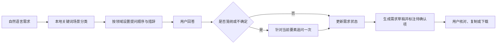

# 需求翻译官｜比赛项目说明（工作稿）

## 1. 项目简介

**需求翻译官**是一款面向需求提出者、产品人员及研发团队的需求澄清 Agent 原型。用户先用自然语言描述想法，Agent 根据场景选择访谈顺序，并针对笼统回答继续追问，最后整理出目标用户、痛点、预期结果、关键流程、范围约束和验收标准等需求草稿。未确定的内容会标注为待确认，不作为已确认事实。

**当前版本的真实实现边界：** 这是无需密钥即可运行的浏览器端规则驱动原型。通过关键词对会议协作、订单查询、研发工具、科研工作等场景进行分类，并据此调整问题顺序和追问表述；对含糊回答触发一次针对性澄清。当前没有接入大语言模型、WorkSwarm、持久化后端或外部业务系统。比赛材料必须将其描述为规则驱动 Agent 原型，不能声称具备模型语义理解或生态平台集成能力。

## 2. 问题与用户

### 问题

业务需求常从“让流程更方便”“提高会议效率”等描述开始。若目标用户、具体痛点、功能边界和验收方式不明确，需求方与产品/研发团队容易反复确认，交付结果也难判断是否满足预期。

### 目标用户

- 不熟悉需求文档写法的业务人员或客户；
- 负责访谈和整理需求的产品经理、项目经理；
- 需要明确边界、流程和验收条件的研发团队。

### 首版应用场景

首版聚焦“产品功能需求澄清”。项目目前用会议管理和订单进度查询作为示例，也包含 Coding 与科研关键词分类。分类仅用于选择问题顺序和措辞，并不代表已完成各行业专业能力。

## 3. 核心用户流程

1. 用户输入模糊想法或选择示例。
2. 规则根据关键词识别需求大类。
3. 系统按场景选择访谈问题顺序及问题措辞。
4. 用户通过自由文本或快捷回答提供信息。
5. 对短、含糊或表达“不确定”的自由文本，系统最多针对当前要素再追问一次；快捷选项作为明确选择处理。
6. 用户可跳过当前问题或澄清追问，跳过项标记为待确认；已录入画像字段可修改。
7. 系统汇总用户回答，明确显示待确认内容，并在草稿中说明各字段来源（用户回答、用户修改或未收集）。
8. 用户可补充信息，查看、复制或下载 Markdown 需求草稿。

## 4. 需求要素与交付结果

访谈覆盖：

- 目标用户；
- 核心痛点；
- 预期结果；
- 关键使用流程；
- 范围与约束；
- 成功/验收标准。

草稿包含需求摘要、目标用户、关键流程、痛点、预期结果、功能需求初稿、范围约束、验收标准草稿、待确认事项、额外补充和能力边界说明。Agent 提出的指标例子是写法建议，不代表用户承诺。

## 5. 技术方案（当前原型）

- **界面：** 原生 HTML、CSS、JavaScript 单页应用；
- **访谈策略：** `web/agent-core.js` 负责本地关键词分类、领域问题顺序、场景化提问、笼统回答判定、一次性追问及补充信息的字段归类；
- **状态管理：** `web/app.js` 在浏览器运行时保存本次会话的回答和状态；当前刷新后会清空；
- **需求输出：** 前端模板生成 Markdown，支持复制及下载；
- **服务依赖：** 无模型 API、无后端、无外部业务数据；
- **隐私边界：** 本原型不上传访谈内容；后续若接入模型或服务端，需重新评估用户告知、密钥管理和数据处理要求。

### 当前工作流

## 6. 项目差异化（当前可验证范围）

1. **以澄清为中心：** 先收集需求要素，再生成文档，而不是直接把一句话扩写成完整方案。
2. **有限度的自适应：** 根据识别出的场景调整问题顺序和措辞；对笼统回答最多追加一次追问。
3. **显式的不确定性：** 将待确认回答与用户确认内容分开；额外补充信息未被安全归类时保留为待确认。
4. **可运行、易体验：** 无需 API 密钥即可体验全部原型流程。
5. **允许跳过与修订：** 用户可跳过问题而不被迫编造答案，也可修改已录入字段；草稿相应保留待确认状态和来源说明。

这些是当前规则原型的能力，不应与大语言模型的开放式语义推理混为一谈。

## 7. 评测计划（待正式实验）

当前已运行 25 条人工编写的规则分类样例（每个场景 5 条）及 8 条含糊回答触发检查，结果见 `docs/evaluation/评测方案与初步结果.md`；这些是小样例规则测试，不能代表真实用户效果。另已完成 1 个 LLM 角色模拟的桌面端到端案例（`docs/evaluation/cases/TC-001-需求翻译官核心澄清流程.md`），模拟回答不等于用户研究。

下一步建议以 8–12 条模糊需求比较固定脚本与场景规则，并邀请至少 5 位非开发者体验。记录：

- 场景分类准确率；
- 关键需求要素收集完整度；
- 含糊回答的追问触发率及追问合理性；
- 用户确认 / 待确认状态标记准确性；
- 文档内容与访谈回答的一致性；
- 完成时间、用户满意度及误解案例。

在真实用户测试前不填报用户效果数值，不作未经验证的效率提升承诺；规则样例通过数仅作为固定测试集结果，并明确标注其局限。

## 8. 风险与后续方向

- 关键词规则可能误分类、漏掉同义表达或误触发追问；需通过测试样例迭代规则。
- 当前不支持真正开放式理解、复杂矛盾检测或多轮语义状态推理。
- 浏览器刷新会清空会话；当前补充字段归类是简单关键词匹配，需用户复核。
- 后续可在确认比赛允许和技术资源具备后，接入模型或 openJiuwen / WorkSwarm；需将模型输出约束为有依据的追问、记录和草稿，并保留确认机制。

## 9. 交互式展示网页讲解流程

展示网页作为首选讲解媒介，不依赖预录视频：

1. 从首页介绍痛点和目标用户。
2. 点击会议协作、订单查询、研发工具示意标签，观察访谈问题如何随场景变化。
3. 下滑查看访谈闭环与当前规则引擎架构。
4. 在内嵌 Demo 中现场输入模糊需求，完成访谈并打开需求草稿。
5. 明确说明当前是规则驱动原型，未接模型或 WorkSwarm；评测指标仍待真实测试。

若官方提交平台明确要求视频或指定演示文件，再按要求制作最小合规补充材料；在确认前不将其作为默认交付物。

## 10. 官方提交材料核对

按参赛者最新决定，当前准备交互式展示网页、可操作 Demo、项目介绍 PPT 及项目文档；预录视频暂不制作，除非官方规则要求。当前 PPT 依据参赛者提供的 7 页模板 PDF 重制，第 2–4 页可编辑，第 5–7 页为模板页图像；尚未找到公开可核验的原生官方 `.pptx` 下载链接。应登录官方提交平台确认模板、Demo 和其他材料格式（核验记录见 `docs/competition-submission-check.md`、`docs/PPT制作说明.md`）。
